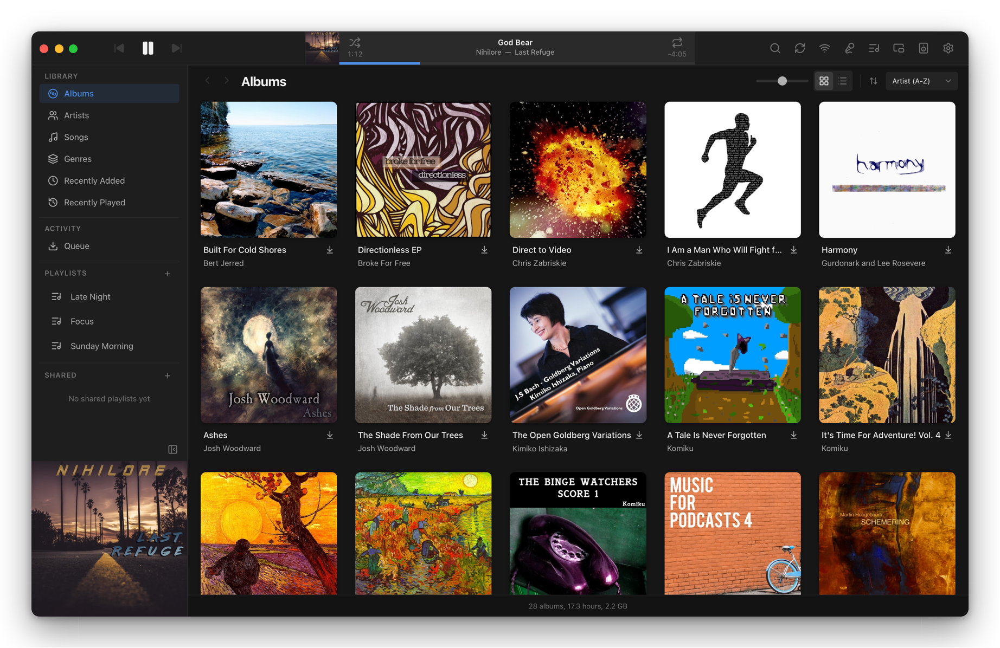
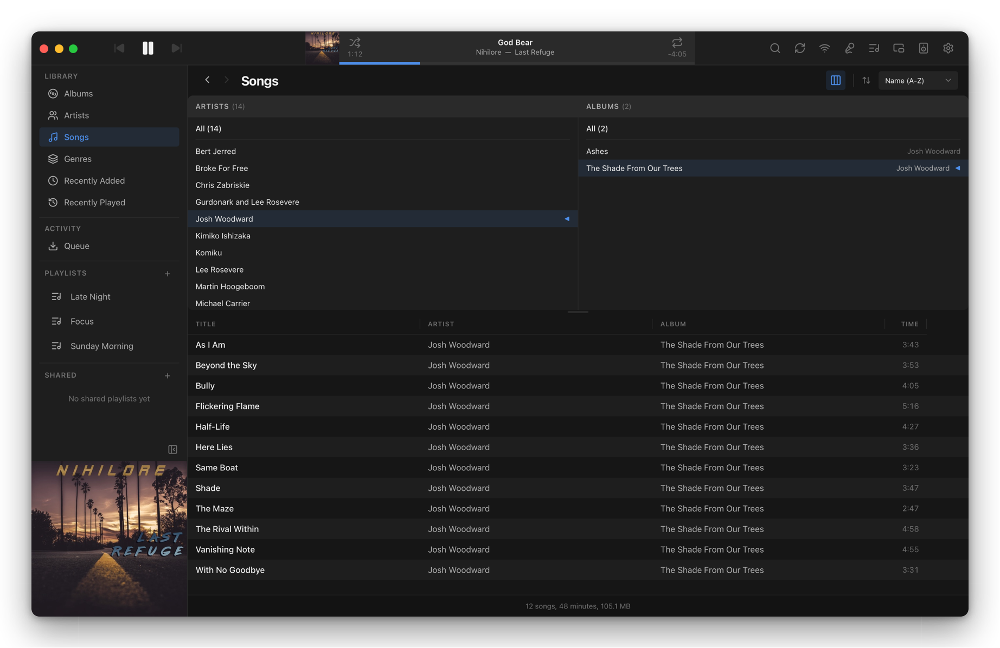

<div align="center">


# Bragi

### The desktop player for your own music server

**Your Jellyfin or OpenSubsonic library on macOS and Linux, browsable even offline.**

**[Download for macOS and Linux](https://github.com/radar-hooves/bragi/releases/latest)**

[](https://tauri.app/)
[](https://www.rust-lang.org/)
[](https://svelte.dev/)
[](LICENSE)

[Installation](#installation) · [Features](#features) · [Documentation](#documentation) · [Contributing](#contributing)

</div>

<div align="center">

</div>

You keep your music on your own server, tagged the way you like it. Bragi is the
player on your desk. It copies the library's details and artwork to your machine,
so browsing and search are instant and keep working when the server is asleep or
you are on a plane. Offline, it plays the albums and songs you have downloaded.
Every play goes to the scrobble service you choose: queued on disk, and retried
until the service accepts it.

---

## Features

<table>
<tr>
<td width="50%" valign="top">

**Your server, your history**

- Jellyfin, or any OpenSubsonic server: Navidrome, Gonic, Airsonic
- Scrobbles to ListenBrainz, Maloja or any ListenBrainz-compatible service, or nowhere
- Every play is queued on disk and retried until the service accepts it
- Leaves your play counts and ratings on the server alone; playlists sync both ways

</td>
<td width="50%" valign="top">

**Works offline**

- Browse and search the whole library offline: its details and artwork are kept locally
- Play offline what you have downloaded, in the format and bitrate you pick, under a cache size you set
- Offline Mode from the toolbar; plays made offline are sent when you reconnect

</td>
</tr>
<tr>
<td width="50%" valign="top">

**Plays it properly**

- mpv underneath: FLAC, Opus, AAC, MP3 and the rest
- Gapless playback, crossfade, fade on pause, ReplayGain and an equaliser
- Choose the output device, and keep playing when headphones come and go
- On macOS, media keys, Control Centre and the lock screen

</td>
<td width="50%" valign="top">

**Browse it your way**

- Albums, artists, songs and genres, as a grid or a list
- A column browser: genre, then artist, then album
- Recently added and recently played
- MusicBrainz IDs as every track's identity

</td>
</tr>
<tr>
<td width="50%" valign="top">

**While it plays**

- Synced lyrics and a full-screen player
- A mini player that can stay on top
- Tray controls, song-change notifications and launch on login

</td>
<td width="50%" valign="top">

**Private by default**

- Talks only to your server, your scrobble service and, if you turn it on, your LLM for playlists from a sentence
- No telemetry unless you point it at your own OpenTelemetry collector
- Share a playlist as a code that another Bragi imports into its own library

</td>
</tr>
</table>

<div align="center">

</div>

---

## Installation

> On macOS, Bragi checks for new versions and installs them in the app.

### macOS

Bragi is not notarised by Apple, so macOS refuses to open it the first time.
You allow it once; after that it opens like any other app.

1. Open the `.dmg` for your Mac (`aarch64` for Apple Silicon, `x64` for Intel) and drag Bragi to **Applications**
2. Open Bragi from **Applications**. macOS says it cannot open it; close that message
3. Allow it:
   - **macOS 15 Sequoia and later:** open **System Settings > Privacy & Security**, scroll to **Security**, click **Open Anyway** (offered for about an hour after step 2), and enter your login password
   - **macOS 13 and 14:** Control-click Bragi in **Applications**, choose **Open**, then click **Open**
   - **macOS 11 and 12:** the same Control-click and **Open**, or **Open Anyway** in **System Preferences > Security & Privacy > General**

<details>
<summary>Alternative: remove the block from Terminal</summary>

```bash
xattr -dr com.apple.quarantine /Applications/Bragi.app
```

</details>

### Linux

1. Download the `.deb` (Debian, Ubuntu) or `.rpm` (Fedora) from the [latest release](https://github.com/radar-hooves/bragi/releases/latest)
2. Install it: `sudo apt install ./Bragi_*.deb` or `sudo dnf install ./Bragi-*.rpm`

Bragi plays through [mpv](https://mpv.io/). The `.deb` installs it for you; with the `.rpm`, install `mpv` first.

### NixOS

```bash
nix profile install github:radar-hooves/bragi
```

Once it is running, the [Getting Started guide](docs/getting-started.md) walks you
through connecting your server, scrobbling and offline listening.

---

## Tech Stack

| Layer    | Choice         | Why                                                    |
| -------- | -------------- | ------------------------------------------------------ |
| Shell    | Tauri 2        | A native window and small binaries on macOS and Linux  |
| Backend  | Rust           | The sync, the cache, the scrobble queue and the player |
| Frontend | Svelte 5       | A reactive interface over a large library              |
| Audio    | mpv            | Every codec, gapless playback and device control       |
| Storage  | SQLite (FTS5)  | The offline library and instant search                 |

---

## Documentation

| Guide                                              | What it covers                                                     |
| -------------------------------------------------- | ------------------------------------------------------------------ |
| [Getting Started](docs/getting-started.md)         | Connecting a server, scrobbling, downloads, Offline Mode, updates |
| [Changelog](CHANGELOG.md)                          | What changed in each release                                       |
| [Screenshot credits](docs/branding/showcase/CREDITS.md) | The freely licensed albums the screenshots show               |

---

## Contributing

Open an issue first to talk through a change.

```bash
pnpm install
pnpm tauri dev    # Development build
pnpm tauri build  # Production build
```

<details>
<summary><strong>Requirements</strong></summary>

- macOS 11 or later, or Linux
- Rust (via [rustup](https://rustup.rs/)), Node.js 22 and pnpm
- mpv on your `PATH`
- Or [Nix](https://nixos.org/) with flakes: `nix develop` gives the whole toolchain, and `direnv allow` loads it on entering the folder

</details>

<details>
<summary><strong>Checks before a pull request</strong></summary>

```bash
pnpm check                                                  # svelte-check
pnpm test                                                   # vitest
cargo clippy --manifest-path src-tauri/Cargo.toml --all-targets -- -D warnings
cargo test --manifest-path src-tauri/Cargo.toml
```

</details>

---

<div align="center">

_Named after Bragi, the Norse god of poetry and song. Its emblem is the Tónlist rune; *tónlist* is Icelandic for "music"._

Built on [Tauri](https://tauri.app/), [mpv](https://mpv.io/), [Svelte](https://svelte.dev/) and [SQLite](https://sqlite.org/). The albums in the screenshots are by independent artists who release their music freely: [see who](docs/branding/showcase/CREDITS.md).

<sub><a href="LICENSE">MIT Licence</a> · <a href="https://github.com/radar-hooves/bragi/issues">Report a bug</a> · <a href="CHANGELOG.md">Changelog</a></sub>

</div>
